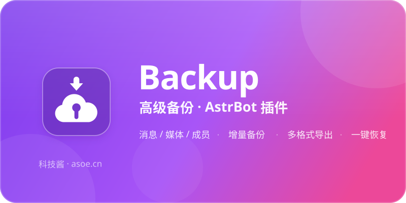

<p align="center">
  
</p>

<p align="center">
  
</p>

# Backup 高级备份

> AstrBot 群聊数据备份插件。把群里的消息、文件、图片、成员、群信息全备份下来，支持定时自动备份、增量备份、多格式导出、一键恢复。群被炸了、机器人迁移、数据审计，都靠它。

<p align="center">
  消息 / 媒体 / 成员全量备份 · 增量备份 · 7 种导出格式 · HTML 聊天记录
</p>

## 功能

**消息备份**
- 群聊消息：文本 / 图片 / 语音 / 视频 / 文件 / 表情 / 合并转发 / 引用回复 / @
- 群公告、群文件列表、群成员（QQ号 / 昵称 / 群名片 / 入群时间 / 角色）、群信息
- 每条消息保留平台原始 JSON（`raw_content`）做保底
- 媒体文件自动下载，文件名 `{message_id}_{url哈希}{ext}`，记录大小 / MIME / SHA-256

**备份方式**
- 手动：`/backup now [群号]`
- 定时：`/backup schedule set <群号> "0 3 * * *"`
- 增量：以 `(timestamp, message_id)` 复合排序记录增量点，首次全量、之后增量；备份中途中断后重跑只补剩下的，不重下已下过的媒体
- 实时归档：消息进群即写库（只写库不下媒体），群被炸/被踢时仍有底；这批数据不会被后续备份改写归属，`export latest` 一律带上
- 触发式：10 分钟内退群数超阈值、群解散、机器人被踢，自动补一次备份

**导出格式**

| 格式 | 产物 | 适合场景 |
| --- | --- | --- |
| `sqlite` | 单文件 `.sqlite` | 二次查询 / 数据分析 |
| `json` | 目录 + 按天分片 | 程序处理 |
| `csv` | 单文件（带 BOM） | Excel 直接打开 |
| `txt` | 单文件 | 纯文本归档 |
| `markdown` | 目录 + 按天分文件 | 阅读 / 存档进 Git |
| `html` | 自包含单文件 | 分享给群友看，仿聊天界面 |
| `zip` | 以上全部 + 媒体 | 完整打包迁移 |

## 安装

```bash
cd AstrBot/data/plugins
git clone <本仓库地址> astrbot-plugin-Backup
pip install -r astrbot-plugin-Backup/backup/requirements.txt
```

重启 AstrBot 后，插件会出现在插件列表中。

## 命令速查

| 命令 | 说明 |
| --- | --- |
| `/backup help` | 帮助 |
| `/backup now [群号]` | 立即备份（不填则当前群） |
| `/backup schedule set <群号> "<cron>"` | 设置定时备份 |
| `/backup schedule list` | 查看定时任务 |
| `/backup schedule remove <群号>` | 移除定时任务 |
| `/backup list [群号]` | 备份列表（不填群号列全部备份，每条带群号） |
| `/backup export [群号] <格式>` | 导出，返回 24 小时有效的临时链接 |
| `/backup restore <备份ID\|备份包路径> [目标群号] --confirm` | 恢复（危险操作，需二次确认） |
| `/backup status [群号]` | 当前群备份状态 |
| `/backup verify <备份ID> [备份包]` | 校验备份完整性 |
| `/backup diff <备份ID1> <备份ID2>` | 对比两个备份 |
| `/backup clean [天数]` | 清理旧备份记录与过期导出/媒体（消息本身不删） |

恢复的冲突策略：`--strategy skip`（默认，跳过已存在）/ `overwrite`（整条覆盖，含内容）/ `merge`（只补库里缺的字段——内容、媒体路径、引用、发送者名字，本地已有的值不动）。

## 配置

配置文件：`backup/config.yaml`

```yaml
backup:
  storage_dir: ""             # 留空 = ~/.astrbot-backup，刻意避开插件目录
  storage:
    web_roots: []             # 数据目录不允许落在这里面，否则启动直接报错
  scope:
    group_messages: true      # 群消息
    private_messages: false   # 私聊（默认关；开则落在虚拟群号 -1 下，命令/导出照旧）
    group_announcements: true # 群公告
    group_files: true         # 群文件列表
    group_members: true       # 成员列表
    download_media: true      # 下载图片/语音/视频/文件
  media:
    max_file_size: "100MB"    # 单文件上限，超过跳过
    max_concurrent: 3         # 并发下载数
    retry_count: 3
    timeout: 30
  schedule:
    enabled: true             # 总闸：关掉则所有 cron 只存不跑
    default_cron: "0 3 * * *"
  retention:
    keep_days: 90
    keep_count: 30
    auto_clean: true
  export:
    default_format: "sqlite"  # /backup export 不带格式时用它
    download_link_expire: "24h"
    base_url: ""              # 下载链接前缀 <base_url>/<token>；留空自动推断（见下）
  dashboard:
    public_url: ""            # 面板公网地址，如 https://bot.example.com
  permission:
    require_admin: true       # 仅群主/管理员可用
    allow_private: true       # 私聊里没有管理员概念，关掉则私聊一律拒绝
  incremental:
    enabled: true
  auto_trigger:
    mass_leave_threshold: 10  # 10 分钟内退群超过该数触发备份
    on_group_disband: true
    on_bot_kicked: true       # 机器人被踢前补最后一次备份
```

## 数据存放

默认在 `~/.astrbot-backup`，不在插件目录里——AstrBot 的 data 目录常被面板静态托管，
备份放那儿等于挂在公网（红线 3）。目录结构：

```
~/.astrbot-backup/
├── db/backup.sqlite   # 消息、成员、群信息、备份记录、增量点、定时任务、下载 token
├── media/             # 媒体文件（按日期分目录）
└── exports/           # 导出产物，只能通过带 token 的临时链接取
```

`storage_dir` 配成绝对路径时按配置走；配成相对路径会相对插件目录解析并打告警；
无论哪种，只要落在 `storage.web_roots` 里就拒绝启动。

### 下载链接怎么用

导出后插件会回一条链接，形状是 `<面板地址>/api/backup/download/<token>`。

- **直接发群里就行。** 这条前缀在 AstrBot 4.14 的 Web 鉴权白名单里，群成员点开即下，
  不需要登录面板。
- **域名从哪来？** 依次找：`export.base_url` → `dashboard.public_url`（以及 AstrBot
  宿主配置里的面板地址）→ **这条 `/backup export` 消息是从哪个域名进来的**（读 `Host`
  与 `X-Forwarded-Host`，反代/内网穿透部署下通常只有这一条可用）。三条都落空才退回裸
  路径并提示你去配。内网地址（`localhost`、`127.x`、`192.168.x`、`10.x`、`172.16-31.x`）
  一律不认——拼出来发到群里没人点得动。
- **token 一次性。** 存在数据库里，重启依然有效，过期即作废，只认 `exports/` 目录内的
  文件。链接转发出去不会被反复领取——但浏览器的 `Range` 探测与续传算同一次下载，不会
  因此变成「下了一半」。
- **想换成自己的网关**，把 `export.base_url` 指过去，网关上兑换 token：

```python
from backup.core.download_route import handle_download, aiohttp_view

# 拿现成的：直接当 aiohttp 视图注册
app.router.add_get("/dl/{token}", aiohttp_view(plugin.exports))

# 或者自己拼响应
resp = handle_download(request.path, plugin.exports, request.headers.get("Range"))
# 200 整份 / 206 区间续传 / 404 路径不对 / 410 过期或已领取 / 416 区间越界
for chunk in resp.iter_chunks():
    ...
```

宿主若是 Flask，直接 `register_web_api` 交给插件自己注册的视图即可，它会返回一个带
`iter_chunks()` 的 WSGI 响应，不需要额外写代码。

## 常见问题

**Q：备份会占多少空间？**
A：文本很少，主要是媒体。不想存媒体就把 `scope.download_media` 关掉，只留文本。

**Q：增量备份会漏消息吗？**
A：不会。增量点用 `(timestamp, message_id)` 复合比较，同一毫秒内的多条消息也能区分。备份中途断掉重跑时，水位取「增量点」和「库里已落库的最新一条」里更靠后的那个，所以中断点之前的数据不会被重拉。

**Q：媒体下载失败会中断备份吗？**
A：不会。失败的文件标记为 `[下载失败]` 并计入记录，备份状态变 `partial`，消息本身照常入库。

**Q：HTML 能直接发给别人看吗？**
A：能。CSS/JS/logo 全部内联，图片 base64 内嵌，单个 `.html` 文件就是完整备份。

**Q：恢复会覆盖现有数据吗？**
A：默认 `skip` 策略不动已有数据。恢复前会二次确认 + 校验完整性，从 ZIP 包恢复也同样把包里的消息和记录里的校验和逐条比对，对不上直接拒绝。

**Q：备份中断了要重跑吗？**
A：重跑就行，已经备份过的部分会自动跳过，包括媒体。中断时增量点不会推进，但库里已有的数据会作为续传下界。

**Q：从 ZIP 包恢复，怎么知道包是完整的？**
A：`verify_zip` 除了全量 CRC 扫描，还比对 manifest 里的校验和、检查包内是否真有消息文件、manifest 登记的媒体是否都在。缺东西会在动手写库之前就报出来。

**Q：同一条消息会被备份两次吗？**
A：不会。消息按 `(message_id, group_id)` 唯一，重跑全量、失败重试、恢复都只留一行，`backup_id` 记最后一次归档它的备份。老版本建的库启动时自动去重。

**Q：群号换了还能恢复吗？**
A：可以。`/backup restore <备份ID> <新群号> --confirm`。

**Q：群公告和群文件列表也会备份吗？**
A：会。每次备份整群覆盖一次快照，ZIP 包里单独存 `announcements.json` / `group_files.json`，
换机器恢复也带得走。接口拉不到只记一条 warning，不影响消息备份。

**Q：私聊消息怎么备？**
A：把 `scope.private_messages` 打开。私聊没有群号，消息统一落在虚拟群号 `-1` 下，
`list` / `export -1 html` 等命令照常用。

**Q：原机器没了，手里只有一个导出包，能恢复吗？**
A：能。包里的 manifest 带着备份记录、群信息和成员名单，所以不用先有本地记录：

```bash
/backup restore /data/backups/xxx.zip --confirm            # 只给包，目标群取包里的群号
/backup restore /data/backups/xxx.zip <新群号> --confirm    # 或另指一个群
/backup restore <备份ID> <新群号> --confirm                  # 本机有记录时仍按 ID 恢复
```

恢复完会按包内信息重建记录与群信息，之后 `list` / `export` 都认得它。

**Q：以前那份备份还能恢复吗？（后来跑过全量备份）**
A：能。每次备份都单独记着「覆盖过哪些消息」，后续备份接手归属不会把它清空。

## 开发与测试

```bash
pip install pytest pytest-asyncio coverage
python -m pytest -q
python -m coverage run --source=backup/core,backup/exporters -m pytest -q && python -m coverage report
```

覆盖率要求 ≥ 80%（当前 90%，按 `backup/core` + `backup/exporters` 口径统计）。
`backup/main.py` 是 AstrBot 接线层，用一份照真实形状写的 astrbot 替身在
`tests/test_round20_plugin_wiring.py` 里跑到 36%——它的 bug 恰恰不在纯逻辑里。

项目结构：

```
backup/
├── metadata.yaml          # 插件元数据
├── _conf_schema.json      # 面板配置 schema（与 config.yaml 同源）
├── main.py                # 命令注册 + 事件钩子（唯一依赖 AstrBot 的文件）
├── config.yaml            # 默认配置
├── logo.png               # 插件市场图标（AstrBot 只认 logo.png）
├── assets/                # SVG 品牌素材（logo / icon / banner）
├── core/                  # 备份、恢复、导出调度、解析、校验、调度器
├── exporters/             # 6 种格式导出器 + ZIP
├── templates/chat.html    # HTML 导出模板（内联样式与脚本）
├── storage/               # 运行时数据（git 忽略）
└── tests/                 # pytest
```

## 贡献

1. Fork 本仓库，切出功能分支
2. 保持 `python -m pytest -q` 全绿，覆盖率不掉
3. 不打印消息内容到日志（隐私红线）
4. 提交 PR，描述里写清改了什么、为什么

## 作者

**科技酱** — 同一个世界，同一个互联网！

| 渠道 | 地址 |
| --- | --- |
| 博客 | https://www.asoe.cn |
| 技术文档 | https://docs.asoe.cn |
| GitHub | https://github.com/techjiang/ |
| 哔哩哔哩 | https://space.bilibili.com/1768832152 |
| 邮箱 | official@tech.asoe.cn |
| 玲珑社区 | https://forums.asoe.cn/ |

QQ 群：291974598 ｜ 474819022 ｜ 631167288

## License

MIT © 科技酱
