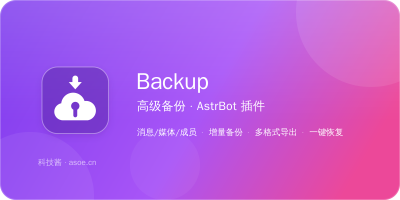

<p align="center">
  
</p>

<p align="center">
  
</p>

# Backup 高级备份

> AstrBot 群聊数据备份插件。把群里的消息、文件、图片、成员、群信息全备份下来，支持定时自动备份、增量备份、多格式导出、一键恢复。群被炸了、机器人迁移、数据审计，都靠它。

<p align="center">
  消息 / 媒体 / 成员全量备份 · 增量备份 · 7 种导出格式 · HTML 聊天记录
</p>

## 功能

**消息备份**
- 群聊消息：文本 / 图片 / 语音 / 视频 / 文件 / 表情 / 合并转发 / 引用回复 / @
- 群公告、群文件列表、群成员（QQ号 / 昵称 / 群名片 / 入群时间 / 角色）、群信息
- 每条消息保留平台原始 JSON（`raw_content`）做保底
- 媒体文件自动下载，文件名 `{message_id}_{url哈希}{ext}`，记录大小 / MIME / SHA-256

**备份方式**
- 手动：`/backup now [群号]`
- 定时：`/backup schedule set <群号> "0 3 * * *"`
- 增量：以 `(timestamp, message_id)` 复合排序记录增量点，首次全量、之后增量；备份中途中断后重跑只补剩下的，不重下已下过的媒体
- 大群：按页拉取，**翻到底的判据是「平台回空页」**，不是「这页给得少」——平台单页封顶 20 条也照样备满；写库按页成批（一页一次事务 + WAL），2 万条消息约 4 秒
- 抗抖动：单页失败退避重试 3 次；重试也失败就降成 `partial` 并写明「停在第几页、保住了多少」，下一轮从断点接着补
- 实时归档：消息进群即写库（只写库不下媒体），群被炸/被踢时仍有底；这批数据不会被后续备份改写归属，`export latest` 一律带上
- 触发式：10 分钟内退群数超阈值、群解散、机器人被踢，自动补一次备份

**导出格式**

| 格式 | 产物 | 适合场景 |
| --- | --- | --- |
| `sqlite` | 单文件 `.sqlite` | 二次查询 / 数据分析 |
| `json` | 目录 + 按天分片 | 程序处理 |
| `csv` | 单文件（带 BOM） | Excel 直接打开 |
| `txt` | 单文件 | 纯文本归档 |
| `markdown` | 目录 + 按天分文件 | 阅读 / 存档进 Git |
| `html` | 自包含单文件 | 分享给群友看，仿聊天界面 |
| `zip` | 以上全部 + 媒体 | 完整打包迁移 |

关于 HTML 两个格式的差别，值得先说清（省得导出完发现附件点不动）：

- `html` 是**单文件**：图片内联成 `data:`，非图片附件带不走，页面上会灰掉并注明
  「需要附件请用 zip」。整份页面的内联总量有上限，超出的图改成链接。
- `zip` 里每一份产物都是**能走的**：`chat.html`、`messages.txt`、`messages.csv`、
  `markdown/*.md`、`json/*.json` 里的媒体地址全部指向包内相对路径 `media/...`，
  解压到任何机器上都能打开、点得动。

## 安装

```bash
cd AstrBot/data/plugins
git clone <本仓库地址> astrbot-plugin-Backup
pip install -r astrbot-plugin-Backup/requirements.txt
```

重启 AstrBot 后，插件会出现在插件列表中。

装完记得做两步（都不做也能跑，但会少东西）：

1. 面板里打开这个插件的配置，把 `export.base_url` 填成网关的**对外地址**
   （反代/内网穿透指向 `gateway.port`）。不填的话导出回执只给裸路径，
   并在回执里说明「这条链接只有本机能用」——因为那时它确实只有本机能用。
2. `storage_dir` 默认落在 `~/.astrbot-backup`，刻意避开插件目录。要换位置就填
   绝对路径；如果新位置在 Web 根下，插件会**拒绝启动**（红线 3）。

## 命令速查

| 命令 | 说明 |
| --- | --- |
| `/backup help` | 帮助 |
| `/backup now [群号]` | 立即备份（不填则当前群） |
| `/backup schedule set <群号> "<cron>"` | 设置定时备份 |
| `/backup schedule list` | 查看定时任务 |
| `/backup schedule remove <群号>` | 移除定时任务 |
| `/backup list [群号]` | 备份列表（不填群号列全部备份，每条带群号） |
| `/backup export [群号] <格式>` | 导出，返回 24 小时有效的临时链接 |
| `/backup restore <备份ID\|备份包路径> [目标群号] --confirm` | 恢复（危险操作，需二次确认） |
| `/backup status [群号]` | 当前群备份状态 |
| `/backup verify <备份ID> [备份包]` | 校验备份完整性 |
| `/backup diff <备份ID1> <备份ID2>` | 对比两个备份 |
| `/backup clean [天数]` | 清理旧备份记录与过期导出/媒体（消息本身不删） |

恢复的冲突策略：`--strategy skip`（默认，跳过已存在）/ `overwrite`（整条覆盖，含内容）/ `merge`（只补库里缺的字段——内容、媒体路径、引用、发送者名字，本地已有的值不动）。

## 配置

配置文件：`config.yaml`（面板里改也行，两边同源）

```yaml
backup:
  storage_dir: ""             # 留空 = ~/.astrbot-backup，刻意避开插件目录
  storage:
    web_roots: []             # 数据目录不允许落在这里面，否则启动直接报错
  scope:
    group_messages: true      # 群消息
    private_messages: false   # 私聊（默认关；开则落在虚拟群号 -1 下，用 -1 寻址）
    group_announcements: true # 群公告
    group_files: true         # 群文件列表
    group_members: true       # 成员列表（关掉就不再去要全员名单）
    download_media: true      # 下载图片/语音/视频/文件
  media:
    max_file_size: "100MB"    # 单文件上限，超过跳过
    max_concurrent: 3         # 并发下载数
    retry_count: 3
    timeout: 30
  schedule:
    enabled: true             # 总闸：关掉则所有 cron 只存不跑
    default_cron: "0 3 * * *"
  retention:
    keep_days: 90
    keep_count: 30
    auto_clean: true
  export:
    default_format: "sqlite"  # /backup export 不带格式时用它
    download_link_expire: "24h"
    base_url: ""              # 群成员点得到的地址，如 https://bak.example.com（见下）
  gateway:
    enabled: true             # 内置下载网关：群内下载链接靠它
    host: "127.0.0.1"         # 只监听回环，对外暴露交给反代
    port: 0                   # 0 = 系统分配
  permission:
    require_admin: true       # 仅群主/管理员可用
    allow_private: true       # 私聊里没有管理员概念，关掉则私聊一律拒绝
  incremental:
    enabled: true
  auto_trigger:
    mass_leave_threshold: 10  # 10 分钟内退群超过该数触发备份
    on_group_disband: true
    on_bot_kicked: true       # 机器人被踢前补最后一次备份
```

### 配置改完立即生效

`/backup config set <键> <值>` 改完当场生效，不必重载插件——每一项都会灌回正在
干活的组件（下载上限、超时、token 有效期、对外地址、权限开关、触发阈值、定时总闸、
网关开关），不只是改配置字典。

唯一例外是 `storage_dir`：换目录等于把正在用的库和已落盘的媒体劈成两半，所以只会在
回执里明说「要重启才生效，当前仍在使用旧目录」。

## 数据存放

默认在 `~/.astrbot-backup`，不在插件目录里——AstrBot 的 data 目录常被面板静态托管，
备份放那儿等于挂在公网（红线 3）。目录结构：

```
~/.astrbot-backup/
├── db/backup.sqlite   # 消息、成员、群信息、备份记录、增量点、定时任务、下载 token
├── media/             # 媒体文件（按日期分目录）
└── exports/           # 导出产物，只能通过带 token 的临时链接取
```

`storage_dir` 配成绝对路径时按配置走；配成相对路径会相对插件目录解析并打告警；
无论哪种，只要落在 `storage.web_roots` 里就拒绝启动。

### 下载链接怎么用

导出后插件回一条链接：

```
<export.base_url>/backup/download/<token>
```

**链接由插件自带的小网关提供，不挂在 AstrBot 面板上。** 这不是偷懒，是面板那条路走不通。

#### 为什么不能挂在面板上

AstrBot 4.14.6 的 `dashboard/server.py` 里有两条同时成立的约束：

1. `srv_plug_route` 的匹配是
   `if route == f"/{subpath}"`——**字符串精确比较**。插件注册的是字面量，
   `"/backup/download/<token>"` 永远不会等于任何真实路径（尖括号不参与比较），
   所以带 token 的路径**一条都命中不了**。
2. `auth_middleware` 的白名单是源码里的常量，按前缀放行 `/api/backup/download`。
   插件能挂的 `/api/plug/*` **不在其中**，一律要面板 JWT——而群里点链接的人没有 JWT。
   唯一免鉴权的那条前缀，已经被宿主自己的 `BackupRoute.download_backup` 占了。

两条一起，把「把链接挂到面板上」这条路堵死。所以插件起自己的网关。

#### 网关怎么配

```yaml
gateway:
  enabled: true      # 默认开
  host: "127.0.0.1"  # 只监听回环，对外暴露交给反代
  port: 0            # 0 = 系统分配；要固定链接就配死一个端口
export:
  base_url: ""       # 群成员点得到的地址，如 https://bak.example.com
```

- 只监听 `127.0.0.1`。**要发到群里，必须配 `export.base_url`** 指到反向代理/内网穿透
  后面那个地址。留空时回执里**不会**出现 `127.0.0.1` 那种链接——那种地址发进群，群成员
  点的是他自己电脑的回环口，一辈子点不开。插件会退回裸路径并明说「只有本机能用」。
- `gateway.port: 0` 由系统分配端口，重启后可能变化；配固定端口 + `base_url` 才稳定。
- 网关起不来（端口被占等）只影响「链接点不点得动」，备份本身照常。

#### 安全

- token 存数据库，重启仍有效，过期即删，只认 `exports/` 目录内的文件。
- 一次性：**第一个领走它的人**用掉即作废，之后的请求 410。浏览器下载大文件会先发
  `Range` 探测再续传，这算同一次下载（15 分钟窗口内），不会变成「下了一半断了」；
  超出窗口的第二个请求就是另一个人，哪怕它也是 `Range` 请求。
- 状态码：`200` 整份 / `206` 区间续传 / `404` 路径不对 / `410` 过期或已领取 / `416` 区间越界。
- 日志不记 token（token 等于一把钥匙，和消息内容一样不该留在日志里）。

#### 想用自己已有的服务

不必开网关，把 `export.base_url` 指过去，在你的服务里兑换 token：

```python
from backup.core.download_route import handle_download

resp = handle_download(request.path, plugin.exports, request.headers.get("Range"))
for chunk in resp.iter_chunks():
    ...
```

## 常见问题

**Q：备份会占多少空间？**
A：文本很少，主要是媒体。不想存媒体就把 `scope.download_media` 关掉，只留文本。

**Q：增量备份会漏消息吗？**
A：不会。增量点用 `(timestamp, message_id)` 复合比较，同一毫秒内的多条消息也能区分。备份中途断掉重跑时，水位取「增量点」和「库里已落库的最新一条」里更靠后的那个，所以中断点之前的数据不会被重拉。

**Q：媒体下载失败会中断备份吗？**
A：不会。失败的文件标记为 `[下载失败]` 并计入记录，备份状态变 `partial`，消息本身照常入库。

**Q：HTML 能直接发给别人看吗？**
A：能。CSS/JS/logo 全部内联，图片 base64 内嵌，单个 `.html` 文件就是完整备份。

**Q：恢复会覆盖现有数据吗？**
A：默认 `skip` 策略不动已有数据。恢复前会二次确认 + 校验完整性，从 ZIP 包恢复也同样把包里的消息和记录里的校验和逐条比对，对不上直接拒绝。

**Q：备份中断了要重跑吗？**
A：重跑就行，已经备份过的部分会自动跳过，包括媒体。中断时增量点不会推进，但库里已有的数据会作为续传下界。

单页网络抖动不会让整轮白跑：会退避重试 3 次（1/3/5 秒）。重试也失败时备份状态变 `partial`，
回执写明「第 N 页拉取失败，已保住前 N-1 页」——已入库的消息是真数据，下一轮接着补。

**Q：备份跑到一半宿主重启了，那条记录怎么办？**
A：启动时会自动收编：`running` 记录降成 `partial`、按已入库的消息补登来源清单，
`/backup list` / `export` / 恢复都认它。原来这种记录会永远挂在 `running`，
恢复直接被「状态为 running，不可恢复」挡回去——而它其实已经保住了上千条消息。

**Q：几千人的大群备得动吗？**
A：备得动，而且按真规模验过。2 万条消息 + 2000 人：备份约 4 秒、导出 HTML 约 1 秒
（7MB 单文件，Chromium 打开 2 万个节点，搜索 37ms）。要点是分页、按页成批写库、
WAL 日志模式——逐条提交的写法在同样数据上要 175 秒。

**Q：从 ZIP 包恢复，怎么知道包是完整的？**
A：`verify_zip` 除了全量 CRC 扫描，还比对 manifest 里的校验和、检查包内是否真有消息文件、manifest 登记的媒体是否都在。缺东西会在动手写库之前就报出来。

**Q：同一条消息会被备份两次吗？**
A：不会。消息按 `(message_id, group_id)` 唯一，重跑全量、失败重试、恢复都只留一行，`backup_id` 记最后一次归档它的备份。老版本建的库启动时自动去重。

**Q：群号换了还能恢复吗？**
A：可以。`/backup restore <备份ID> <新群号> --confirm`。

**Q：群公告和群文件列表也会备份吗？**
A：会。每次备份整群覆盖一次快照，ZIP 包里单独存 `announcements.json` / `group_files.json`，
换机器恢复也带得走。接口拉不到只记一条 warning，不影响消息备份。

**Q：私聊消息怎么备？**
A：把 `scope.private_messages` 打开。私聊没有群号，消息统一落在虚拟群号 `-1` 下，
`list` / `export -1 html` 等命令照常用。

**Q：从 ZIP 恢复，媒体（图片/语音/文件）也会回来吗？**
A：会。恢复时包里的 `media/` 会被落回本机存储目录、登记进媒体表，消息里的路径
改成这台机器的真实路径，回执里会写「媒体 N 个已落回本机」。之后再用 `/backup export`
导出的包里照样带着这些媒体——不会出现「恢复一次、图就没了」。

**Q：原机器没了，手里只有一个导出包，能恢复吗？**
A：能。包里的 manifest 带着备份记录、群信息和成员名单，所以不用先有本地记录：

```bash
/backup restore /data/backups/xxx.zip --confirm            # 只给包，目标群取包里的群号
/backup restore /data/backups/xxx.zip <新群号> --confirm    # 或另指一个群
/backup restore <备份ID> <新群号> --confirm                  # 本机有记录时仍按 ID 恢复
```

恢复完会按包内信息重建记录与群信息，之后 `list` / `export` 都认得它。

**Q：以前那份备份还能恢复吗？（后来跑过全量备份）**
A：能。每次备份都单独记着「覆盖过哪些消息」，后续备份接手归属不会把它清空。

## 开发与测试

```bash
pip install pytest pytest-asyncio coverage
python -m pytest -q
python -m coverage run --source=core,exporters -m pytest -q && python -m coverage report
```

覆盖率要求 ≥ 80%（当前 90%，按 `core/` + `exporters/` 口径统计）。

**接线层要拿真 AstrBot 验**。`main.py` 的 bug 从来不在纯逻辑里：
`@filter.command` 到底是不是「注册 handler」、`CommandFilter` 会不会 inspect 签名、
真 pipeline 会不会把一条通知送进两个钩子——这些只有装一份 AstrBot 才能确定。

```bash
git clone https://github.com/AstrBotDevs/AstrBot.git && pip install -e AstrBot
python -m pytest -q      # tests/test_round28_real_astrbot_loader.py 自动生效
```

没装时那一组自动 skip（不是「不用验」，是「这个环境验不了」）。它只假一件事：
OneBot 客户端——那本来就是平台本身。

项目结构（**插件根 = 仓库根**）：

```
.
├── metadata.yaml          # 插件元数据
├── _conf_schema.json      # 面板配置 schema（与 config.yaml 同源）
├── main.py                # 命令注册 + 事件钩子（唯一依赖 AstrBot 的文件）
├── config.yaml            # 默认配置
├── requirements.txt       # 宿主装插件时会读它
├── logo.png               # 插件市场图标（AstrBot 只认 logo.png）
├── assets/                # SVG 品牌素材（logo / icon / banner）
├── core/                  # 备份、恢复、导出调度、解析、校验、调度器
├── exporters/             # 6 种格式导出器 + ZIP
├── templates/chat.html    # HTML 导出模板（内联样式与脚本）
└── tests/                 # pytest
```

**为什么必须是仓库根**：AstrBot 的插件加载器（`PluginManager._get_modules`）只认
`<插件目录>/main.py` 或 `<插件目录>/<目录名>.py`，目录里没有就直接跳过。所以这些
文件不能收进 `backup/` 这样的子目录——收进去的表现是：插件列表里根本没有它，
日志只有一句「未找到 main.py 或者 xxx.py，跳过」。

运行时数据不在这里，见下面的 `storage_dir`。

## 贡献

1. Fork 本仓库，切出功能分支
2. 保持 `python -m pytest -q` 全绿，覆盖率不掉
3. 不打印消息内容到日志（隐私红线）
4. 提交 PR，描述里写清改了什么、为什么

## 作者

**科技酱** — 同一个世界，同一个互联网！

| 渠道 | 地址 |
| --- | --- |
| 博客 | https://www.asoe.cn |
| 技术文档 | https://docs.asoe.cn |
| GitHub | https://github.com/techjiang/ |
| 哔哩哔哩 | https://space.bilibili.com/1768832152 |
| 邮箱 | official@tech.asoe.cn |
| 玲珑社区 | https://forums.asoe.cn/ |

QQ 群：291974598 ｜ 474819022 ｜ 631167288

## License

MIT © 科技酱
